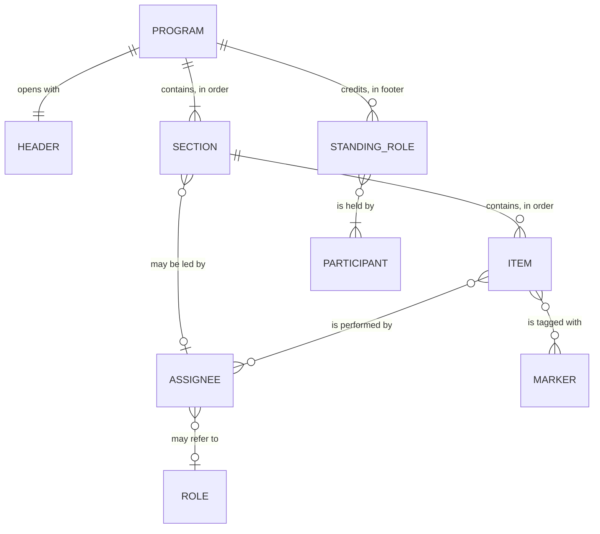
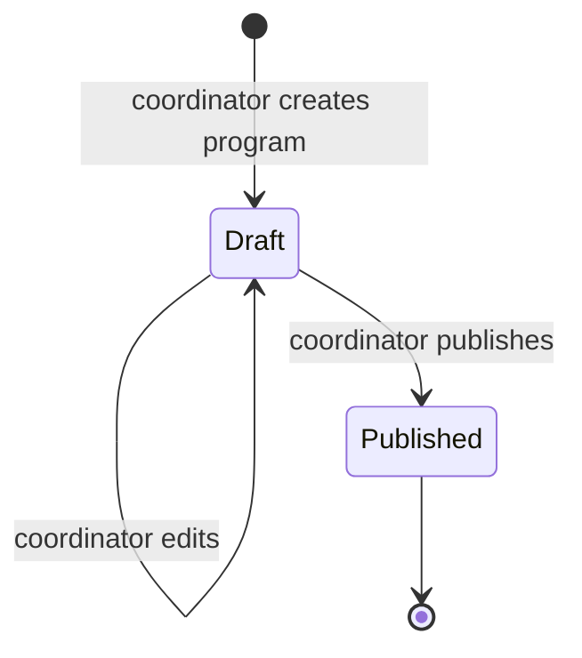

# Program rundown: concepts and vocabulary

This document defines the terms program-rundown uses for the structure of a program list.
It settles the vocabulary first, so the data model and the app can build on it later.
It is conceptual: it names things and their attributes, and it does not prescribe storage, schema, or UI.

All names of people in the examples are placeholders.

## 1. Core concepts

### Program

A **Program** is the composed document that lists, in order, what happens during an event and who does each part.
People also call it a program rundown, a program listing, an order of service, or a bulletin insert.
In this project, "program" always means the document, never the gathering.

Example: the "Divine Service" sheet handed to attendees at a 10:30 a.m. worship service is one Program.

### Event

An **Event** is the real-world gathering that a Program describes: a worship service, a wedding, a graduation, a conference session.
The event happens once, at a place and time; the Program is a description of its flow.
program-rundown composes and publishes Programs.
It does not manage the event itself (venue booking, attendance, ticketing, rehearsals).

| | Event | Program |
|---|---|---|
| What it is | The gathering | The document about the gathering |
| Example | Saturday worship at 10:30 a.m. | The printed "Divine Service" sheet |
| Who acts on it | Everyone present | Coordinators write it; attendees read it |
| Can have versions | No | Yes (draft, then published) |

### Coordinator and Reader

Two audiences use a Program in different ways.

- A **Coordinator** composes the Program: picks the sections and items, fills in hymn titles, and assigns people.
  Example: the program coordinators named in the footer of the sample sheet.
- A **Reader** follows the Program during the event to know what comes next and who leads it.
  Example: an attendee holding the sheet, or someone viewing it on a phone.

A person can be both: a coordinator also reads the published Program on the day.
Note that "Congregation" also appears inside the sample Program as an assignee (the people who sing a hymn).
That use is a [Participant](#participant), not the Reader audience, even though it is the same people.

### Draft and Published

A Program has a **status**.

- **Draft**: the coordinator is still composing it.
  Readers do not see it.
- **Published**: the coordinator has released it to readers, for printing or sharing.

Example: on Wednesday the coordinator drafts Saturday's Program with "Speaker: TBA".
On Friday the coordinator fills in the speaker and publishes it.

What happens when a coordinator changes a Program after publishing is an [open question](#7-open-questions).

### Fits any program, not only worship

The model describes any program that follows the same shape: a header, ordered sections of ordered items, each item with someone responsible, and a list of standing roles.
Worship services are the first and main case, so examples use worship terms.
Nothing in the vocabulary depends on worship.

Example of the same shape outside worship (a school graduation):

```text
COMMENCEMENT EXERCISES
4:00 p.m.

OPENING
  *Processional                                Graduates
  *National Anthem                             Glee Club
  Opening Remarks                              Principal

RECOGNITION
  Presentation of Candidates                   Registrar
  Conferring of Diplomas                       Principal

KEYNOTE ADDRESS                      ALEX EXAMPLE
                                     Guest Speaker, Example University

  Closing Song      "Alma Mater"               Everyone

Master of Ceremonies | Sam Sample
Program Coordinator | Riley Placeholder
```

## 2. Anatomy of a program list

The sample sheet has five structural parts, top to bottom.
The outline below rebuilds the sample with placeholder names; the hymn titles are kept because they are the public titles of common hymns.

```text
                       DIVINE SERVICE                     <- Header: title
                         10:30 a.m.                       <- Header: start time

WORSHIP THROUGH PRAISE                                    <- Section heading
  Praise Songs                              Congregation  <- Item: label + assignee

CALL TO WORSHIP                                 Presider  <- Section heading + section assignee
  *Introit         "Holy, Holy, Holy"       Congregation  <- Item: marker + label + detail + assignee
  Hymn of Celebration "We Love Thy Sabbath Lord" Congregation
  Invocation                                     Speaker  <- assignee is a role reference
  Hymn of Adoration                         Congregation
  Scripture Reading                       Jamie Example   <- assignee is a named person
  *Prayer Hymn  "As We Come to You in Prayer" Congregation
  *Pastoral Prayer                        Jamie Example
  *Hymn of Response  "O Thou Who Heareth"   Congregation

WORSHIP THROUGH GIVING
  Thoughts on Stewardship                  Casey Sample
  Offertory Music                          Morgan Pianist
  Hymn of Gratitude "Praise God, From Whom All Blessings" Congregation
  Offertory Prayer                         Casey Sample

WORSHIP THROUGH HIS WORDS
  Ministry in Song                         Taylor Singer

THE SPOKEN WORD                     DR. ALEX PLACEHOLDER  <- Featured block: heading + featured person
                         Education Director, Example Conference  <- Featured block: subtitle

  Hymn of Consecration                      Congregation  <- Items after the featured block
  Hymn of Hope     "The Mission"            Congregation
  Benediction                                    Speaker

            Presider | Sam Sample                         <- Footer: standing role + person
     Choristers | Pat Example and Lee Example             <- one role, two people
            Pianist | Morgan Pianist
     Deacons | Chris Example & Drew Example
 Program Coordinator | Robin Sample & Jordan Sample
```

How the parts relate (conceptual only, not a schema):



The featured block is left out of this picture on purpose: where it fits is open question 4.

## 3. Vocabulary

Each term below has a definition and an example from the sample (with placeholder names).

### Header

The **Header** is the top block that identifies the Program.
It holds:

- **Title** (required): the name of the program as readers see it.
  Example: `DIVINE SERVICE`.
- **Start time** (optional): when the event starts.
  Example: `10:30 a.m.`.
- **Date** (optional): the day of the event.
  The sample shows no date, because a sheet handed out on the day does not need one.
  A Program shared online or archived usually does.
- Other optional header lines, such as a venue or a theme, may appear on other programs; the sample has none.

### Section

A **Section** is an ordered group of items under one heading.
A Program has one or more sections, and their order is the order of the event.

Attributes:

- **Heading**: the section's title, usually in capitals.
  Example: `WORSHIP THROUGH PRAISE`, `CALL TO WORSHIP`.
- **Section assignee** (optional): a person or role who leads the whole section, shown on the heading line.
  Example: `CALL TO WORSHIP` shows `Presider` on its heading line, meaning the presider leads that part.
- **Items**: the ordered items in the section.
  A section can have a single item, such as `WORSHIP THROUGH HIS WORDS` with only `Ministry in Song`.

### Item

An **Item** is one line in a section: one thing that happens, in order.
"Item" is the proposed term; "element" and "line" are the alternatives (see [open questions](#7-open-questions)).

Attributes:

- **Label** (required): what happens.
  Example: `Hymn of Celebration`, `Invocation`, `Offertory Prayer`.
- **Detail** (optional): the specific content of this item, such as a hymn title or a scripture reference.
  Titles show in quotes and italics.
  Example: `"We Love Thy Sabbath Lord"` on the `Hymn of Celebration` item.
  Many items have no detail, such as `Invocation`.
- **Assignee** (usually present): who performs the item.
  Example: `Congregation`, `Jamie Example`, `Speaker`.
- **Markers** (optional): symbols that tag the item.
  Example: the `*` before `*Introit`.

### Assignee

An **Assignee** is whoever is responsible for an item, a section, or a featured block.
The sample shows four kinds:

| Kind | Meaning | Example |
|---|---|---|
| Person | A named participant | `Jamie Example` on `Scripture Reading` |
| Several people | Two or more named participants together | `Pat Example and Lee Example` |
| Group | A collective, not a list of names | `Congregation`, `Everyone`, `Choir` |
| Role reference | A role whose holder is named elsewhere in the Program | `Speaker` on `Invocation`; `Presider` on `CALL TO WORSHIP` |

A role reference lets the coordinator name the person once and refer to the role everywhere else.
In the sample, `Speaker` resolves to the person in the featured block, and `Presider` resolves to the footer entry `Presider | Sam Sample`.

### Participant

A **Participant** is a person who takes part in the Program.
The same participant can appear many times: in items, in the featured block, and in the footer.

Example: `Morgan Pianist` performs `Offertory Music` and is also credited as `Pianist | Morgan Pianist` in the footer.
`Jamie Example` performs both `Scripture Reading` and `Pastoral Prayer`.

A participant may carry an **honorific** and a **subtitle**, which matter mostly in the featured block.
Example: honorific `Dr.`, subtitle `Education Director, Example Conference`.

### Role

A **Role** is a named function in the Program that a participant fills.
Example: `Presider`, `Speaker`, `Pianist`, `Choristers`, `Deacons`, `Program Coordinator`.

A role is not a person.
The `Speaker` role exists in every worship Program; who holds it changes each week.

### Standing role

A **Standing role** is a role held for the whole Program rather than for one item.
Standing roles appear in the [Footer](#footer).
Example: `Presider`, `Pianist`, `Deacons`.

A standing role can be held by one or more participants.
Example: `Deacons | Chris Example & Drew Example`.

### Marker

A **Marker** is a short symbol before an item's label that tells readers something about that item.
Example: `*` before `*Introit`, `*Prayer Hymn`, `*Pastoral Prayer`, and `*Hymn of Response`.

A marker has a meaning, given by a **marker legend**.
The sample sheet does not print its legend.
In many order-of-service sheets, `*` means "please stand"; this reading is inferred from common practice, not stated on the sample.

### Featured block

A **Featured block** is a highlighted part of the Program that presents one featured participant, usually the main speaker.
It is larger and more prominent than an item.

Attributes:

- **Heading**: what the featured part is.
  Example: `THE SPOKEN WORD`.
- **Featured participant**: shown large, with an optional honorific.
  Example: `DR. ALEX PLACEHOLDER`.
- **Subtitle** (optional): the participant's title or affiliation.
  Example: `Education Director, Example Conference`.

The featured block has no label-detail-assignee lines of its own.
Its participant usually also holds a role used elsewhere: in the sample, `Speaker` on `Invocation` and `Benediction` points to this person.

### Footer

The **Footer** is the closing block that lists the Program's standing roles and who holds them.
Each line is one standing role and its participants, written `Role | Participant(s)`.

Example:

```text
Presider | Sam Sample
Choristers | Pat Example and Lee Example
Program Coordinator | Robin Sample & Jordan Sample
```

The separator (`|`) and the joiner between names (`and`, `&`) are presentation choices, not data.

## 4. What the sample shows beyond the basic shape

These details in the sample affect the model and are easy to miss.

- **A section heading can carry an assignee.**
  `CALL TO WORSHIP` shows `Presider` on its heading line, so the presider leads the whole section.
- **Items can follow the featured block without a new heading.**
  `Hymn of Consecration`, `Hymn of Hope`, and `Benediction` come after `THE SPOKEN WORD` with no heading of their own.
  They may belong to the featured section, or to an unheaded closing section (see [open questions](#7-open-questions)).
- **One assignee can be several people.**
  `Pat Example and Lee Example` hold `Choristers` together.
- **Assignees mix people, groups, and roles in the same section.**
  `CALL TO WORSHIP` has `Congregation`, `Speaker`, and `Jamie Example` as assignees.
- **No item shows its own time.**
  Only the header has a time.
- **The printed sheet carries other content.**
  The reverse side of the sample shows an announcements page.
  Announcements are not part of the program list and are out of scope for this document.

## 5. Program lifecycle

A Program moves from draft to published.



Whether a published Program can return to draft, or be edited in place, is an open question.

## 6. Glossary

| Term | Definition | Example |
|---|---|---|
| Program | The composed document listing the order of an event and who does each part | The "Divine Service" sheet |
| Event | The real-world gathering a Program describes; not managed by program-rundown | Saturday worship at 10:30 a.m. |
| Coordinator | A person who composes and publishes a Program | A program coordinator |
| Reader | A person who follows a published Program | An attendee holding the sheet |
| Status | Whether a Program is a draft or published | Draft |
| Header | The top block: title, start time, optional date | `DIVINE SERVICE`, `10:30 a.m.` |
| Section | An ordered group of items under a heading | `CALL TO WORSHIP` |
| Heading | The title of a section or featured block | `WORSHIP THROUGH GIVING` |
| Section assignee | A person or role who leads a whole section | `Presider` on `CALL TO WORSHIP` |
| Item | One ordered line in a section | `Hymn of Celebration` line |
| Label | What happens in an item | `Offertory Prayer` |
| Detail | Optional specific content of an item, such as a hymn title | `"Holy, Holy, Holy"` |
| Assignee | Who performs an item: a person, several people, a group, or a role reference | `Congregation` |
| Participant | A person who takes part in the Program | `Jamie Example` |
| Group | A collective assignee that is not a list of names | `Congregation` |
| Role | A named function a participant fills | `Speaker` |
| Role reference | An assignee that names a role whose holder appears elsewhere | `Speaker` on `Benediction` |
| Standing role | A role held for the whole Program, credited in the footer | `Pianist` |
| Marker | A symbol before an item label that tags the item | `*` |
| Marker legend | The meaning of each marker | `*` = please stand (inferred) |
| Featured block | A highlighted part that presents a featured participant | `THE SPOKEN WORD` |
| Honorific | A courtesy title before a participant's name | `Dr.` |
| Subtitle | A participant's title or affiliation shown under the name | `Education Director, Example Conference` |
| Footer | The closing list of standing roles and their holders | `Presider \| Sam Sample` |

## 7. Open questions

The model has real choices on these points; each needs a decision before the data model.

1. **Time per item.**
   Is time only a property of the Program (the start time), or can each item or section also have a time or duration?
   The sample shows only a start time, but a conference agenda would need per-item times.
2. **Date.**
   Is a date a required part of the Program, optional, or taken from the Event?
   The sample shows no date.
3. **Markers.**
   Is there a fixed set of markers with a standard legend, or does each Program define its own markers and legend as free text?
   Should the legend print on the Program?
4. **Featured block.**
   Is the featured block a special kind of Section, a special kind of Item, or an attribute of a Section?
   Do the items after it (`Hymn of Consecration`, `Hymn of Hope`, `Benediction`) belong to it, or to an unheaded section?
5. **Unheaded sections.**
   Can a Section have no heading?
6. **Term for a within-section line.**
   Item, Element, or Line?
   This document uses Item: "Line" describes layout, and "Element" is too generic.
7. **Assignee model.**
   Is an assignee always one value of one kind, or a list that can mix people, groups, and role references?
   Is a group such as `Congregation` a special participant or its own kind?
8. **Section assignee.**
   Is a section assignee its own attribute, or an item without a label?
9. **Detail kinds.**
   Is a detail free text, or does it have kinds (song title, scripture reference, note) that change how it displays?
10. **Editing after publish.**
    Can a published Program be edited in place, or does a change create a new version?
    Do readers see that it changed?
11. **Role resolution.**
    Must every role reference (such as `Speaker`) resolve to a standing role or featured participant in the same Program?
    What does a reader see when it does not?
